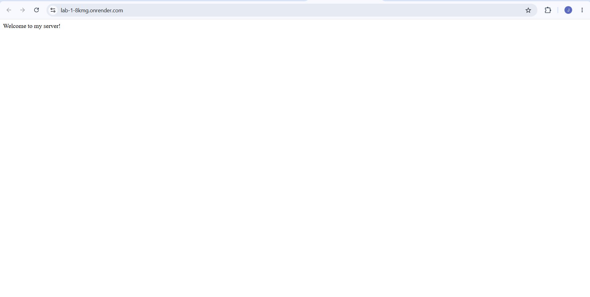
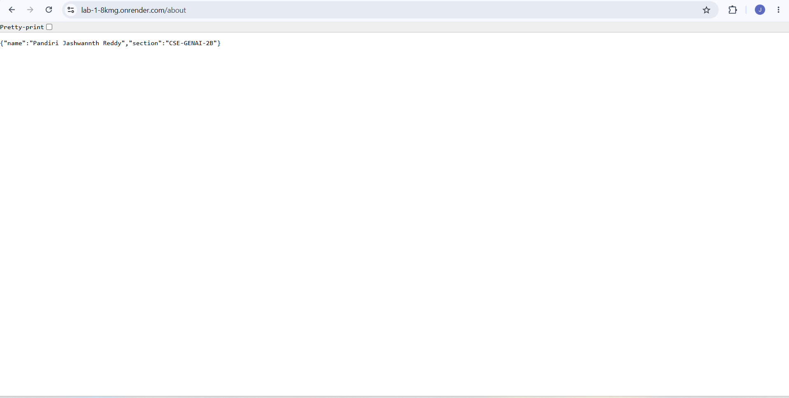
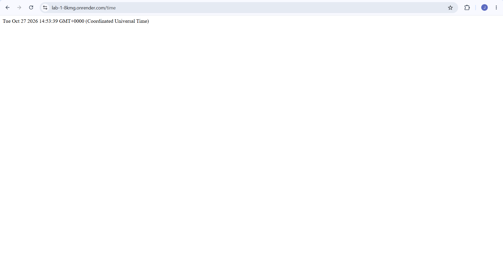
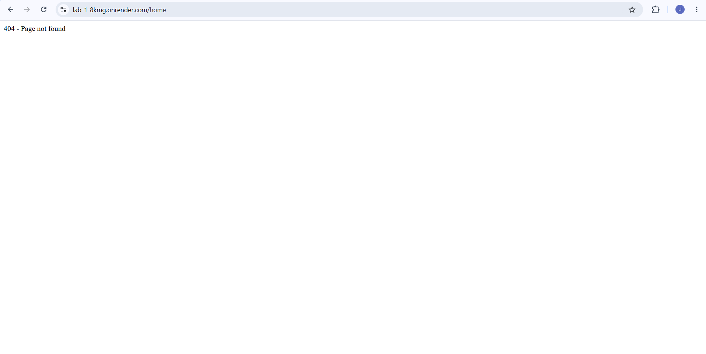

# Lab 1: Node.js and Express Server

**Course:** Backend Development Fundamentals  
**Lab:** 1 — Node.js and Express Server  
**Name:** PANDIRI JASHWANTH REDDY  
**Registration Number:** 252U1R9116  
**Section:** CSE-GENAI-2B  

## Live Link

https://lab-1-8kmg.onrender.com/

## Objective

To set up a Node.js project, create a basic HTTP server using the built-in `http` module, and build a web server using Express.js with multiple routes and appropriate HTTP status codes.

## Technologies Used

- Node.js
- Express.js
- JavaScript
- npm (Node Package Manager)

## Project Structure

```text
lab-01/
├── server.js
├── package.json
├── package-lock.json
├── .gitignore
├── README.md
└── screenshots/
    ├── home.png
    ├── about.png
    ├── time.png
    └── not-found.png
```

## Prerequisites

- Node.js and npm installed
- A web browser
- A code editor such as Visual Studio Code

## Installation and Setup

1. Clone the GitHub repository:

   ```bash
   git clone YOUR_GITHUB_REPOSITORY_URL
   ```

2. Navigate to the lab folder:

   ```bash
   cd YOUR_REPOSITORY_NAME/lab-01
   ```

3. Install the dependencies:

   ```bash
   npm install
   ```

4. Start the server:

   ```bash
   node server.js
   ```

5. Open the following URL in your browser:

   ```text
   http://localhost:3000
   ```

**Environment variables:** None required for the current lab configuration.

## Endpoints

| Method | Endpoint | Description | Expected Status |
|---|---|---|---|
| GET | `/` | Displays a welcome message | 200 OK |
| GET | `/about` | Returns name and section as JSON | 200 OK |
| GET | `/time` | Returns the current date and time | 200 OK |
| GET | Any unknown path | Returns a 404 Not Found message | 404 Not Found |

## Screenshots

### 1. Home Route

Displays the welcome message.



### 2. About Route

Displays the name and section in JSON format.



### 3. Time Route

Displays the current date and time.



### 4. 404 Not Found Route

Displays an error message for an unknown path.



## Implementation Summary

- Initialized the Node.js project using `npm init -y`.
- Installed Express.js using `npm install express`.
- Created a basic HTTP server using `http.createServer()`.
- Created an Express application using `express()`.
- Implemented GET routes for `/`, `/about`, and `/time`.
- Implemented a 404 response for unknown routes.
- Tested the endpoints and their HTTP status codes.
- Deployed the application on Render.

## Viva Questions

**1. What is the difference between `package.json` and `node_modules`?**

`package.json` contains project information and dependency details, while `node_modules` contains the installed packages.

**2. What does `app.listen()` do?**

It starts the Express server and makes it listen for incoming requests on a specified port.

**3. What do request and response represent?**

`req` represents the incoming HTTP request, and `res` is used to send an HTTP response to the client.

## Problems Faced and Solutions

- **Problem:** Setting up the Node.js project and installing dependencies.  
  **Solution:** Initialized the project using npm and installed Express.js.

- **Problem:** Configuring routes and HTTP status codes.  
  **Solution:** Implemented Express routes and tested their responses in the browser.

## Conclusion

Successfully created and deployed a Node.js and Express.js web server with multiple GET endpoints and a 404 error handler as part of Lab 1 of Backend Development Fundamentals.
